# Synthesizer

<!-- Final CAD Images -->
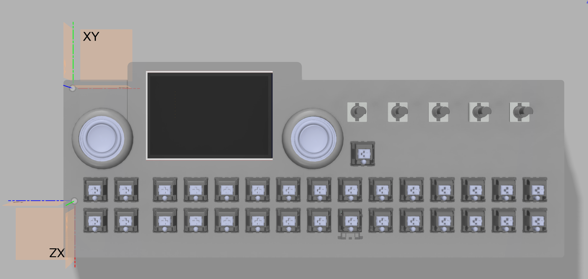
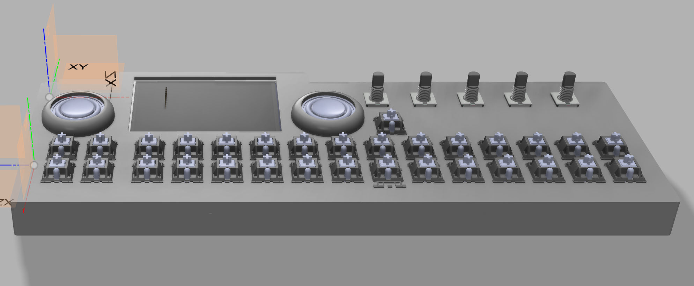
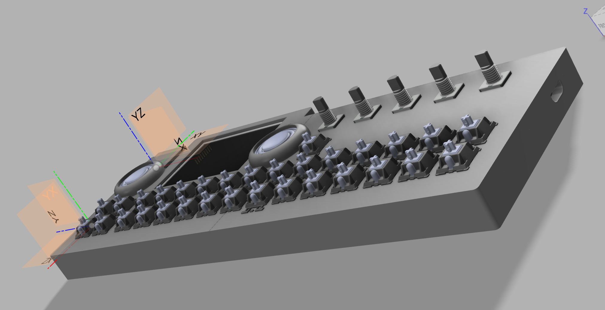
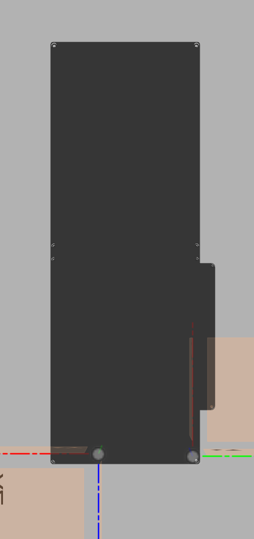

A portable, standalone digital synthesizer and musical workstation featuring a 30-key hot-swap mechanical keyboard (26 musical piano keys and 4 customizable performance pads), 5x EC11 rotary encoders, and a vibrant TFT display. Powered by the ESP32-S3-WROOM-1-N16R8 microcontroller and backed by a massive 10,000mAh LiPo battery with a dedicated physical ON/OFF slide switch and IP5306 wake/activation button, ChronosSynth delivers studio-grade 32-bit I2S DAC audio through dual stereo speakers or an auto-switching 3.5mm headphone jack, complete with per-key addressable RGB illumination, MicroSD sample storage, and native USB Type-C connectivity.

## Features & Hardware Design

[Full Schematic](Images/schematics.png)

### 30-Key Matrix & Backlighting
Features a 30-key tactile mechanical deck (26 staggered piano keys and a 2x2 customizable control pad cluster) arranged in a 5-row by 6-column diode-protected matrix (`1N4148W`)[cite: 13, 14]. Utilizes Kailh MX hot-swap sockets for solderless switch swapping. Paired with 35x RGB LEDs (`SK6812MINI-E`) for per-key and status glow.

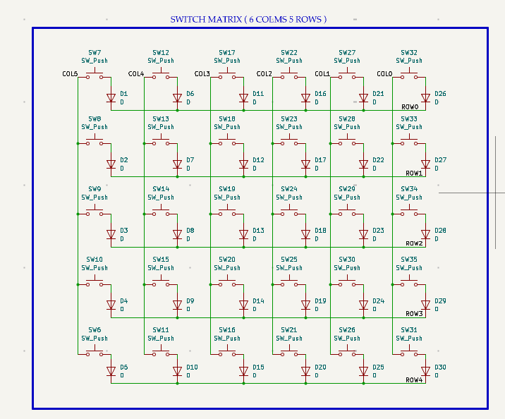

### Audio Engine & Output
High-fidelity digital audio synthesis is handled via an onboard `PCM5102A` 32-bit I2S DAC with passive RC low-pass output filtering. Audio is routed through a `PJ-307` 5-pin auto-switching 3.5mm stereo headphone jack that automatically mutes the onboard `PAM8403D` (3W x 2 Class-D) stereo speaker amplifier when headphones are plugged.

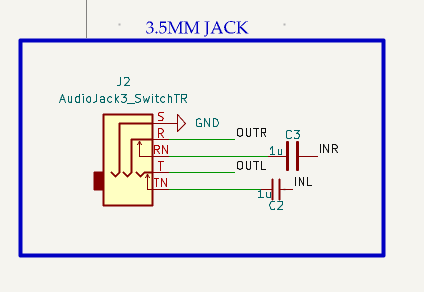

### Connectivity & Storage
A dual USB Type-C architecture separates high-current battery charging from native USB data, firmware flashing, and USB Type-C communication. An onboard SMD push-pull MicroSD card slot is wired over a dedicated high-speed SPI bus, saving custom synth patches, and recording MIDI sequences.

### Power & Battery
Powered by a high-capacity **10,000mAh 3.7V LiPo battery**  controlled via a master **Power ON/OFF slide switch**. Integrated battery management (`IP5306`) provides safe USB-C charging, a dedicated tactile push button (`KEY`) to activate/wake the charging and boost IC, and a regulated `+5V` output rail for the Class-D audio amplifier and RGB LED chain. An `AP2112K-3.3` LDO voltage regulator steps `+5V` down to a clean, low-noise `+3.3V` rail for the digital logic, screen, and DAC.

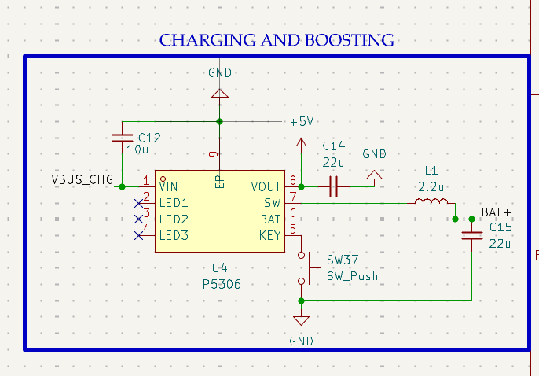

### Microcontroller (ESP32-S3)
The `ESP32-S3-WROOM-1-N16R8` (16MB Flash, 8MB Octal PSRAM) serves as the brain of the workstation, handling real-time polyphonic audio synthesis, direct GPIO key matrix scanning, DMA-driven SPI display rendering, and USB-MIDI output.

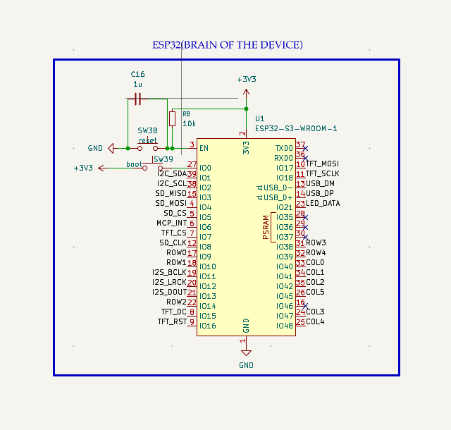

### Rotary Encoders & I2C Port Expander
Five `EC11` rotary encoders with integrated push switches provide real-time tactile control over synthesis parameters . All 15 encoder signals are routed through an `MCP23017-E/SO` 16-bit I2C port expander and hardware interrupt to keep main MCU pins free for the switch matrix and dual SPI buses.

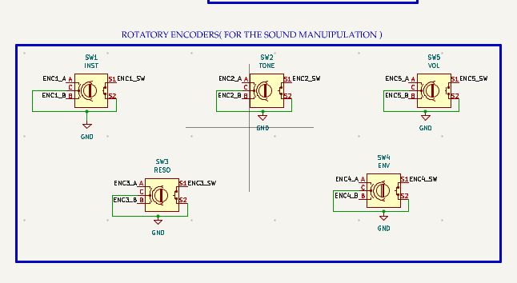

### Display Interface
Integrated color TFT display (3.5" / 1.9" `ST7789` IPS SPI interface) driven over a dedicated hardware SPI bus for live waveform visualization, instrument selection, envelope graphs, and battery status 

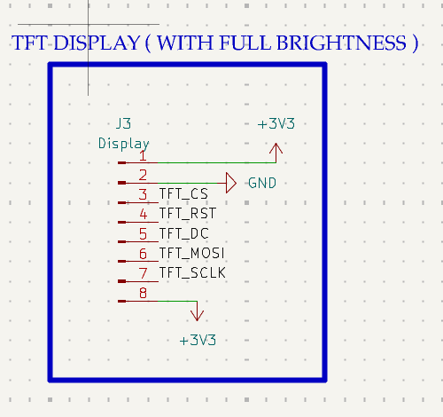

---

## PCB Layout & Specifications
The hardware is built on a custom **2-layer FR4 PCB** measuring approximately **300mm x 100mm**. Both Top and Bottom layers feature continuous **Ground (`GND`) copper pours** to shield high-speed SPI/I2S digital lines and keep the analog audio path free of switching noise.

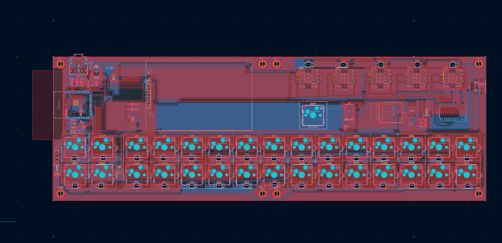
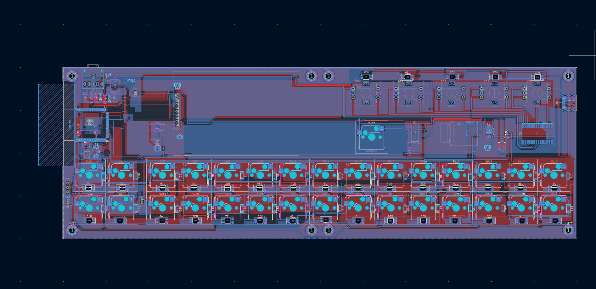

---

## CAD & 3D-Printed Enclosure
To fit on standard desktop 3D printer beds despite its 300mm+ width, the enclosure is split into **4 modular interlocking sections**:
* **Top Left Faceplate**
* **Top Right Faceplate**
* **Bottom Left Shell**
* **Bottom Right Shell**

### Enclosure Assembly Instructions

1. **Bottom Shell Assembly (Bottom Left + Bottom Right):**
   The bottom tray is split into left and right halves featuring a precision mechanical alignment interlock. The **Bottom Left** half features circular alignment grooves (**10mm diameter, 2.5mm depth**), while the **Bottom Right** half features matching extruded alignment bosses/rods (**10mm diameter, 2.5mm height**). Apply (super glue) to the mating faces, press the alignment rods firmly into the grooves so the bottom tray sits completely flush, and allow it to cure.

   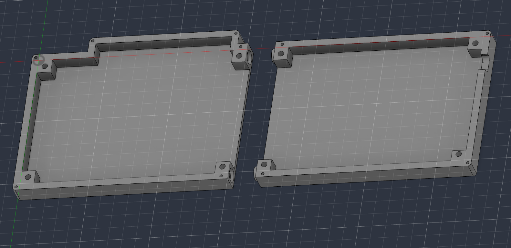

2. **Top Faceplate Assembly (Top Left + Top Right):**
   The top control faceplate halves use the exact same **10mm diameter x 2.5mm** groove-and-rod interlocking alignment system. Apply super glue to the inner seam, align the cylindrical pins into their mating recesses, and clamp until bonded.

   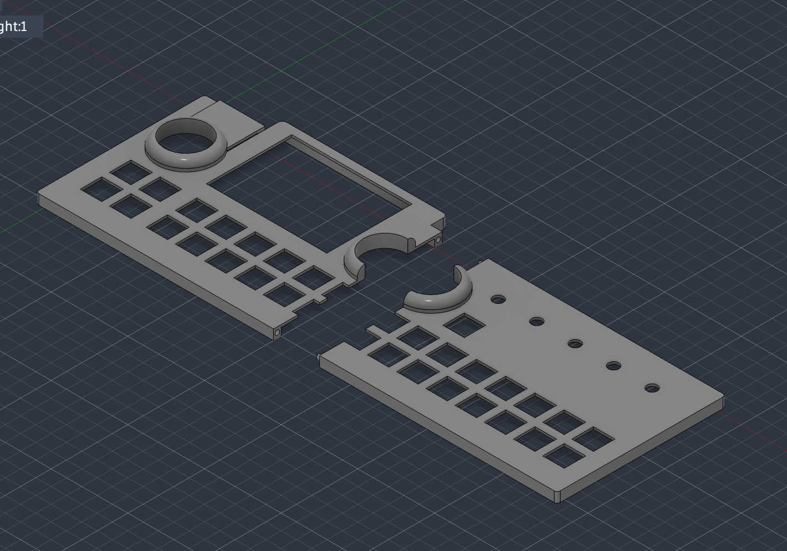

## Firmware
The current is prototype and not tested it will be tested and updated in future and then the hardware will me manufactured. Full end-to-end testing, feature integration, and fine-tuning will be completed once hardware production and assembly are finalized.

## Bill of Materials (BOM)

| Part | Description | Qty | Unit Price (USD) | Total Price (USD) | Vendor |
| :--- | :--- | :---: | :---: | :---: | :--- |
| **Espressif ESP32-S3-WROOM-1-N16R8** | MCU Module | 1 | $4.73 | $4.73 | Robu.in |
| **MCP23017-E/SO** | 16-Bit I2C GPIO Expander | 1 | $2.44 | $2.44 | LCSC India |
| **PCM5102A** | 32-Bit I2S Digital-to-Analog Converter (DAC) | 1 | $4.38 | $4.38 | LCSC India |
| **PAM8403** | Class-D Stereo Audio Amplifier | 1 | $1.97 | $1.97 | LCSC India |
| **IP5306** | Power Bank / LiPo Charger & 5V Boost IC | 1 | $2.39 | $2.39 | LCSC |
| **AMS1117-3.3** | 3.3V LDO Voltage Regulator | 1 | $0.83 | $0.83 | LCSC India |
| **SJ1-3525NG-GR** | 3.5mm Stereo Audio Jack with Internal Switch | 1 | $1.22 | $1.22 | LionCircuits |
| **Mechanical Key Switches** | Tactile/Linear Switches (Packs of 10) | 5 | $2.11 | $10.55 | Meckeys |
| **EC11 Rotary Encoder** | Sound / Parameter Control Knobs | 5 | $0.61 | $3.05 | Robu.in |
| **SMD Power Inductor (2.2uH)** | Shielded Power Inductor | 1 | $1.17 | $1.17 | LCSC India |
| **Kailh MX Hot-Swap Sockets** | Hot-Swap Switch Sockets (Packs of 10) | 4 | $0.84 | $3.36 | Meckeys |
| **SK6812MINI-E** | Addressable RGB LEDs (Packs of 10) | 4 | $0.56 | $2.24 | LCSC India |
| **SMD Resistors** | Passive Resistors (Assorted Values) | 40 | $0.01 | $0.40 | Ktron |
| **SMD Capacitors** | Passive Capacitors (Assorted Values) | 30 | $0.01 | $0.30 | Ktron |
| **3.7V LiPo Battery** | Rechargeable Battery Pack | 1 | $4.20 | $4.20 | MakerBazar |
| **Total** | | | | **$43.23** | |