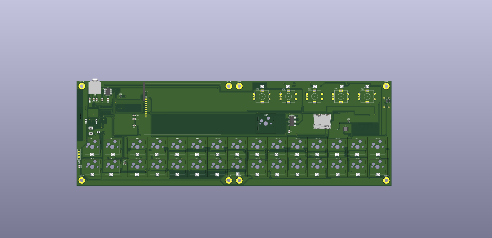
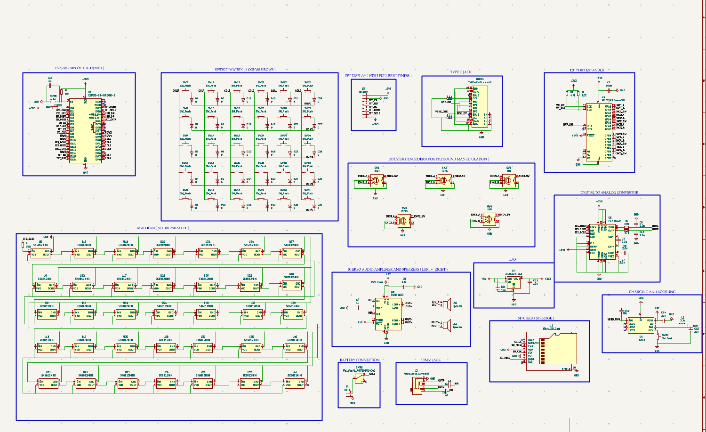

# Synthesizer

A portable standalone digital synthesizer workstation featuring a 1.9" IPS TFT display, 32-bit I2S DAC audio engine, dual stereo speakers, and 5x EC11 rotary encoders. Powered by the ESP32-S3-WROOM-1-N16R8 microcontroller, this project utilizes Kailh MX hot-swap mechanical switches with per-key RGB illumination and a custom 3D-printed enclosure secured with M3 heat-set inserts. A project by Chronos.

## Features & Hardware Design

### 30-Key Matrix & Backlighting
Features a 30-key tactile mechanical deck (26 staggered piano keys and a 2x2 control pad cluster) arranged in a 5-row by 6-column diode-protected matrix (`1N4148W`). Utilizes Kailh MX hot-swap sockets for solderless switch swapping. Paired with 35x addressable RGB LEDs (`SK6812MINI-E` / `WS2812B`) for per-key and status illumination.

### Audio Engine & Output
High-fidelity digital audio synthesis is handled via an onboard `PCM5102A` 32-bit I2S DAC with passive RC low-pass output filtering. Audio is routed through a `PJ-307` 5-pin auto-switching 3.5mm stereo headphone jack that automatically mutes the onboard `PAM8403D` (3W x 2 Class-D) stereo speaker amplifier when headphones are plugged in.

### Connectivity & Storage
A dual USB Type-C architecture separates high-current battery charging from native USB data, firmware flashing, and USB-MIDI communication. An onboard SMD push-pull MicroSD card slot is wired over a dedicated high-speed SPI bus for loading WAV samples, saving custom synth patches, and recording MIDI sequences.

### Power & Battery
Integrated LiPo battery management (`IP5306`) provides safe charging via USB-C and boosts the 3.7V LiPo cell (`JST-PH 2.0mm`) to a regulated `+5V` rail (filtered with a `2.2uH` power inductor and `22uF` bulk capacitors) for the Class-D audio amplifier and RGB LED chain. An `AP2112K-3.3` LDO voltage regulator steps `+5V` down to a clean, low-noise `+3.3V` rail for the digital logic and DAC.

### Microcontroller (ESP32-S3)
The `ESP32-S3-WROOM-1-N16R8` (16MB Flash, 8MB Octal PSRAM) serves as the brain of the workstation, handling real-time polyphonic audio synthesis, direct GPIO key matrix scanning, DMA-driven SPI display rendering, and USB-MIDI output.

### Rotary Encoders & I2C Port Expander
Five `EC11` rotary encoders with integrated push switches provide real-time tactile control over synthesis parameters (`INST`, `TONE`, `RESO`, `ENV`, `FX/VOL`). All 15 encoder signals (`A`, `B`, and `SW`) are routed through an `MCP23017-E/SO` 16-bit I2C port expander (`I2C_SDA`, `I2C_SCL`, and hardware interrupt `MCP_INT`) to keep main MCU pins free for the switch matrix and dual SPI buses.

### Display Interface
Integrated 1.9" `ST7789` IPS TFT display driven over a dedicated hardware SPI bus (`TFT_SCLK`, `TFT_MOSI`, `TFT_CS`, `TFT_DC`, `TFT_RST`) for live waveform visualization, instrument selection, envelope graphs, and battery status feedback.

## Full Schematics & PCB Layout
- **Full System Schematic:** *[Iimages/]*
- **PCB Layout (Top & Bottom Copper):** *[Add Link / Image Here]*
- **3D PCB Render & Populated Board:** *[Add Link / Image Here]*

## Case Stack-up & CAD Dimensions
The enclosure uses a custom 3D-printed top faceplate, integrated switch plate, and bottom shell designed for standard Cherry MX-style switches, dual oval speakers, and top-mounted controls.

| Layer | Thickness / Dimension | Notes |
| :--- | :--- | :--- |
| **Top Plate** | 1.5 mm | Exact thickness required for Cherry MX side-clips to snap in securely. Features 14x14mm switch cutouts, speaker grilles, and display bezel. |
| **Switch Gap** | 5.0 mm | Physical space between the bottom of the top plate and the top of the PCB. |
| **PCB** | 1.6 mm | Standard FR4 board thickness. |
| **Bottom Case Clearance** | 8.0 mm (Min) | Clearance required below the PCB to safely house Kailh MX hot-swap sockets, SMD components, and the 3.7V LiPo pouch cell. |

**Mounting Hardware:** Secured using M3 brass heat-set inserts melted into the case bosses (CAD hole diameter: 4.0mm, extruded 1mm deeper than the insert length) and standard M3 screws.

## Firmware
The firmware establishes the core real-time audio synthesis, peripheral management, and input scanning pipeline for the workstation.

- **Audio Synthesis & I2S Pipeline:**
  - Uses the ESP32-S3 hardware I2S controller (`I2S_BCLK` on `IO11`, `I2S_LRCK` on `IO12`, `I2S_DOUT` on `IO13`) with DMA buffers to stream low-latency 16-bit/32-bit PCM audio directly to the `PCM5102A` DAC.
  - Utilizes the 8MB Octal PSRAM for wavetable storage and sample playback buffered from the SPI MicroSD slot.
- **Matrix & Encoder Scanning:**
  - Configured for a `COL2ROW` diode-isolated matrix scanning routine across 6 columns (`COL0`–`COL5`) and 5 rows (`ROW0`–`ROW4`), fully matched to the onboard `1N4148W` diode orientations (`D1`–`D30`) for full N-key rollover when playing chords.
  - Polls the `MCP23017` over 400kHz I2C triggered via the `MCP_INT` hardware interrupt (`IO6`) for instantaneous reading of the 5x `EC11` rotary encoders and push switches.
- **UI & USB-MIDI Output:**
  - Renders live oscilloscope waveforms and parameter dials to the `ST7789` display while driving the 35-LED `SK6812MINI` chain via the RMT peripheral (`IO21`).
  - Enumerates as a class-compliant USB-MIDI device over the native USB-C port (`IO19`/`IO20`) for seamless DAW integration.

**Development Note:** This firmware is currently an untested starter draft. It is provided as a foundational template and testing version. Full end-to-end testing, feature integration, and fine-tuning will be completed once the hardware production is complete. I will make sure to update the firmware as soon as I am done with the hardware.

